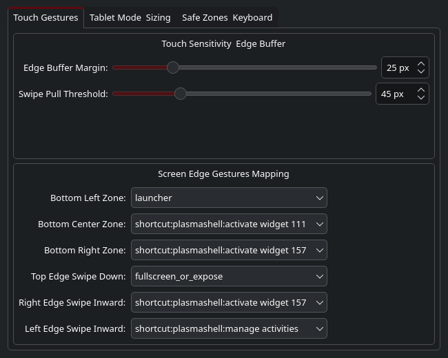
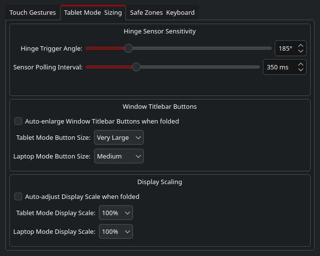
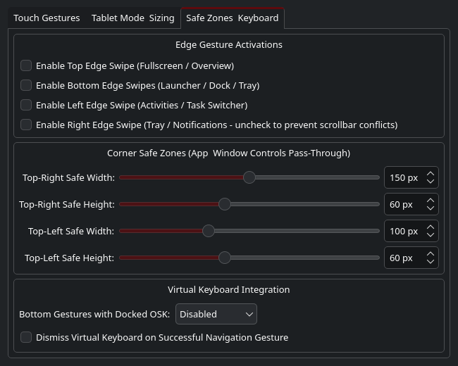

# KWin Touch Gesture Plus

[](https://www.gnu.org/licenses/gpl-2.0.html)
[](https://kde.org/plasma-desktop/)
[](https://wayland.freedesktop.org/)
[](tests/)

**KWin Touch Gesture Plus** is a high-performance touchscreen edge gesture and tablet optimization suite for **KDE Plasma 6 (Wayland)**.

It resolves the long-standing "edge tap conflict" in KWin by introducing **pending-touch arbitration** into the core compositor, while delivering an **extensible, data-driven multi-zone gesture engine** with automatic tablet mode scaling.

---

## The Problem Solved: Taps vs. Gestures

In standard KDE Plasma 6 Wayland, registering touch edge gestures causes KWin's input filter to immediately swallow any touch down that begins within 25 px of a screen border. As a result:
- **Tapping window close buttons, tabs, or scrollbars near screen edges is ignored or lost.**
- **Typing on the on-screen keyboard loses spacebar and modifier taps near the bottom edge.**
- **Dragging or scrolling parallel to the border is mistakenly hijacked as an inward gesture.**

**KWin Touch Gesture Plus solves this through low-level input arbitration:**
1. Touches starting in the edge margin enter a non-blocking **Pending** state with a 150 ms intent window.
2. If the user taps, scrolls parallel, or pauses, the buffered events are replayed downstream to the application instantly.
3. If the user intentionally swipes inward past 44 px, the gesture cleanly commits and fires the mapped system action.

---

## Screenshots

| Touchscreen Edge Gestures | Tablet Mode & Dynamic Scaling |
| :---: | :---: |
|  |  |
| *Tab 1: Configurable pull thresholds, OSK policies & edge triggers* | *Tab 2: 360° hinge sensor monitoring & automatic button scaling* |

| Corner Safe Zones | Live Desktop & Multi-Zone Gestures |
| :---: | :---: |
| 
| *Tab 3: Top-left and top-right exclusion zones for tabs & buttons* | *HP Elite Dragonfly G1 running KWin 6.7.5 in live tablet mode* |

---

## Key Features

- **Pending-Touch Edge Arbitration (V5 Production)**:
  - Zero dropped taps on browser tabs, titlebars, close buttons, and menus.
  - Incomplete swipes (20–30 px) abort cleanly and preserve original touch history.
  - Latched commitment: crossing 44 px guarantees gesture trigger even if the finger retreats before lifting.
  - Multi-touch handoff and fail-closed quarantine if a target window closes during pending input.
- **Extensible Data-Driven Gesture Zones**:
  - Split any screen edge into multiple independent action regions (default: 3 bottom zones, top, left, right).
  - Normalized continuous coordinates (`0.0` to `1.0`) adapt dynamically to screen rotation and scaling.
  - Safe-zone corner exclusion (top-left tab margin, top-right close-button margin).
  - Deterministic priority conflict resolution for overlapping custom zones.
- **Extensible Action System**:
  - **KDE Global Shortcuts** (`shortcut:<component>:<action>`)
  - **External Programs** via secure `QProcess` argument vectors (`exec:<program> [args...]`)
  - **D-Bus Method Calls** (`dbus:<service>:<path>:<iface>:<method>`)
  - **KWin Builtins** (`launcher`, `fullscreen_or_expose`, `overview`, `expose`, `show_desktop`, `virtual_keyboard`)
- **Virtual Keyboard (OSK) Integration**:
  - `Disabled`: Automatically silences bottom edge gestures when the on-screen keyboard is visible to prevent typing mis-hits.
  - `SplitGapOnly`: Only allows navigation swipes originating from the center gap between keyboard halves.
- **Hardware Tablet Mode Automation**:
  - Sensor-driven 360° hinge angle detection (IIO quaternion sensor).
  - Hardware switch monitoring (`SW_TABLET_MODE` via evdev).
  - Automatic titlebar button scaling (Breeze, Klassy, SierraBreezeEnhanced) and display DPI switching.

---

## Input Pipeline Architecture

```
Physical Touchdown -> libinput -> KWin ScreenEdgeInputFilter
                                         |
                                         v
                         [ ScreenEdgeGestureRecognizer ]
                                         |
                  +----------------------+----------------------+
                  |                                             |
           Inward Swipe >= 44px                       Stationary Tap / Parallel
                  |                                             |
                  v                                             v
         [ Latched Commitment ]                       [ Replay Buffer Downstream ]
                  |                                             |
                  v                                             v
       QAction::triggered()                            Application Window
                  |                                    (Button / Tab Clicked)
                  v
         [ ZoneManager Match ]
                  |
                  v
        [ ActionRegistry Run ]
     (Launcher / Task Switcher / Custom)
```

For full details, see [docs/architecture.md](docs/architecture.md).

---

## Installation

The project consists of two layers:
1. **The Core Input Arbitration Patch** (applied to KWin source).
2. **The KWin Touch Gesture Plus Plugin & Effect** (installs on top of KWin).

### Option A: Arch Linux / CachyOS (Automated Package)

1. Build the patched KWin package:
   ```bash
   cd packaging/arch
   cp ../../kwin-patches/*.patch .
   makepkg -s --skippgpcheck
   sudo pacman -U kwin-6.7.5-3.5-*.pkg.tar.zst
   ```
2. Build and install the plugin:
   ```bash
   ./install.sh
   ```
3. Log out and back into KDE Plasma.

### Option B: Generic Linux (Manual Build)

1. Apply the 4 patches in [`kwin-patches/`](kwin-patches/) to your KWin 6.x source tree and compile KWin.
2. Build and install the plugin:
   ```bash
   mkdir build && cd build
   cmake .. -DCMAKE_INSTALL_PREFIX=/usr -DBUILD_TESTING=ON
   cmake --build .
   sudo cmake --install .
   ```
3. Copy the effect configuration UI:
   ```bash
   mkdir -p ~/.local/share/kwin/effects/tablet_gestures
   cp -r kwin_effect/* ~/.local/share/kwin/effects/tablet_gestures/
   ```
4. Reconfigure KWin:
   ```bash
   qdbus6 org.kde.KWin /KWin reconfigure
   ```

---

## Enabling and Configuring Settings

You can enable and customize gestures, tablet auto-scaling, and safe zones via GUI or CLI.

### Method 1: Graphical Interface (KDE System Settings)

1. Open **System Settings** and go to **Window Management** -> **Desktop Effects**.
2. Scroll to the **Accessibility** section and check the box next to **Tablet Touch & Edge Gestures** to enable it.
3. Click the **Configure (gear icon)** next to the effect to open the configuration dialog:
   - **Tab 1: Touch Gestures & Actions**:
     - Toggle gestures individually for **Top**, **Bottom**, **Left**, and **Right** edges.
     - Adjust the **Swipe Pull Threshold** (default: `45 px`).
     - Customize actions for screen edges and split bottom zones (**Bottom Left**, **Bottom Center**, and **Bottom Right**).
     - **Action Dropdowns**: All action selectors offer direct selection of built-in actions, custom commands (e.g., `Custom: <Title>`), or a dedicated navigation option `⚙ Custom Command... (Add / Edit)` that jumps directly to Tab 2 to add or edit custom commands.
     - *System Tray vs Notifications:* The **Bottom Right Zone Action** offers both:
       - **System Tray Popup Menu (`activate widget 145`)** *(Default)*: Opens the system tray flyout menu (status icons, clipboard, audio, network).
       - **Notifications Panel (`activate widget 157`)**: Opens the dedicated KDE notifications history panel.
     - Select **Bottom Navigation with Keyboard** behavior (`Disabled` prevents mis-hits on spacebar/enter while typing, `SplitGapOnly` allows swipes only between keyboard halves).
   - **Tab 2: Custom Commands (Custom Commands Pack)**:
     - Add and edit custom commands up to the number of configured gesture hotspots. Each command keeps a stable identifier (`custom_N`); existing configurations using `CustomCommandsJson` (automatically migrated from legacy `CustomCommand1` through `CustomCommand5`) are migrated automatically.
       - New installations start with an empty command list and blank editor fields.
       - The command limit is derived from the number of configured gesture hotspots.
       - **Blank Title Auto-Replacement**: When adding or saving a command, leaving the Title field blank automatically populates it with the command string itself.
       - Existing commands retain stable `custom_N` IDs when edited; removed commands clear any edge mapping that referenced them.
     - Built-in syntax guide for `exec:<program>`, shell scripts, `shortcut:<component>:<action>`, and `dbus:...`.
   - **Tab 3: Tablet Mode & Titlebars**:
     - Enable automatic detection via 360° hinge sensors or hardware switches.
     - Configure automatic window titlebar button resizing (e.g. *Medium* for laptop mode, *Very Large* for tablet mode) across Breeze, Klassy, and SierraBreezeEnhanced.
     - Configure display DPI scaling between tablet and laptop modes.
   - **Tab 4: Corner Safe Zones**:
     - Set top-left exclusion width (default: `100 px`) to protect browser tabs and navigation buttons.
     - Set top-right exclusion width (default: `150 px`) to protect window close, minimize, and maximize buttons.
4. Click **Apply** or **OK**.

### Method 2: Command Line (`kwriteconfig6` & D-Bus)

Settings can be inspected and updated directly from the terminal without opening System Settings:

```bash
# 1. Enable or disable the Desktop Effect
kwriteconfig6 --file kwinrc --group Plugins --key tablet_gesturesEnabled true

# 2. Configure edge actions
# Set Bottom Right corner to System Tray Popup Menu (widget 145)
kwriteconfig6 --file kwinrc --group Effect-tablet_gestures --key BottomRightAction "shortcut:plasmashell:activate widget 145"

# Or set Bottom Right corner to a Custom Command from the pack
kwriteconfig6 --file kwinrc --group Effect-tablet_gestures --key BottomRightAction "custom_1"

# 3. Add or modify commands in the Custom Commands Pack
kwriteconfig6 --file kwinrc --group Effect-tablet_gestures --key CustomCommand1 "exec:/usr/bin/konsole"
kwriteconfig6 --file kwinrc --group Effect-tablet_gestures --key CustomCommand4 "exec:flatpak run org.mozilla.firefox"

# Alternatively, set custom commands live via D-Bus:
qdbus6 org.kde.TabletGestures /TabletGestures setCustomCommand 1 "exec:/usr/bin/konsole"

# 4. Set Swipe Activation Threshold (in pixels)
kwriteconfig6 --file kwinrc --group Effect-tablet_gestures --key SwipeThreshold 45

# 5. Reload KWin configuration and the gesture plugin dynamically
qdbus6 org.kde.KWin /KWin reconfigure
qdbus6 org.kde.TabletGestures /TabletGestures org.kde.TabletGestures.reloadConfig
```

### Method 3: Extensible Multi-Zone JSON

For advanced setups with arbitrary edge partitioning, custom shell commands, or D-Bus calls, create or edit `~/.config/kwin-touch-gesture-plus/zones.json` (see [Custom Zones Example](#custom-zones-example) below and [docs/configuration.md](docs/configuration.md)).

---

## Custom Zones Example

Edit `~/.config/kwin-touch-gesture-plus/zones.json` (or inspect [`config/default_zones.json`](config/default_zones.json)):

```json
{
  "version": "1.0",
  "zones": [
    {
      "id": "bottom_left_launcher",
      "name": "Application Launcher",
      "edge": "bottom",
      "startFraction": 0.0,
      "endFraction": 0.333,
      "action": "launcher",
      "oskPolicy": "Disabled"
    },
    {
      "id": "bottom_center_dock",
      "name": "Toggle Dock",
      "edge": "bottom",
      "startFraction": 0.333,
      "endFraction": 0.666,
      "action": "shortcut:plasmashell:activate widget 111",
      "oskPolicy": "Disabled"
    },
    {
      "id": "bottom_right_terminal",
      "name": "Launch Terminal",
      "edge": "bottom",
      "startFraction": 0.666,
      "endFraction": 1.0,
      "action": "exec:/usr/bin/konsole",
      "oskPolicy": "Disabled"
    }
  ]
}
```

Reload zones without restarting KWin:
```bash
qdbus6 org.kde.TabletGestures /TabletGestures org.kde.TabletGestures.reloadConfig
```

See [docs/gestures-and-zones.md](docs/gestures-and-zones.md) for advanced multi-zone partitioning.

---

## Automated Test Verification

This project includes unit and integration tests:

- **Unit Tests**:
  ```bash
  mkdir build && cd build
  cmake .. -DBUILD_TESTING=ON
  cmake --build .
  ctest --output-on-failure
  ```
  *Result: 2/2 targets passed (21 assertions passed, 0 failed).*
- **KWin Core Integration Tests**:
  ```bash
  ctest -R testScreenEdges --output-on-failure
  ctest -R testTouchInput --output-on-failure
  ```
  *Result: 49 passed, 0 failed.*

---

## Documentation

- **[Architecture & Input Arbitration](docs/architecture.md)**
- **[Configuration Guide](docs/configuration.md)**
- **[Gestures, Zones & Actions](docs/gestures-and-zones.md)**
- **[Upstreaming & KDE Roadmap](docs/upstreaming.md)**
- **[Troubleshooting & Diagnostics](docs/troubleshooting.md)**

---

## Roadmap

- [x] Core Pending-Touch Arbitration inside `ScreenEdgeGestureRecognizer`
- [x] Incomplete gesture history replay and latched commitment
- [x] Multi-touch and quarantine state recovery
- [x] Data-driven `ZoneManager` with normalized fractions
- [x] Decoupled `ActionRegistry` supporting Shortcuts, `QProcess`, and D-Bus
- [x] Hardware IIO hinge angle and switch tablet mode detection
- [ ] Direct visual zone editor within the KDE System Settings QML page
- [ ] KDE Upstream Merge Request for core arbitration

---

## License

This project is licensed under the **GNU General Public License v2.0 or later** ([GPL-2.0-or-later](LICENSE)), matching KDE KWin licensing requirements.

---

## AI Disclosure

This project was researched, architected, developed, and verified with the assistance of **Antigravity** (an agentic AI coding assistant developed by Google DeepMind) paired with a human engineer. All architectural designs, low-level C++ patch implementations, regression test suites, and hardware-in-the-loop QA testing were reviewed, compiled, and validated on physical touchscreen and 360° convertible tablet hardware running KDE Plasma 6.

